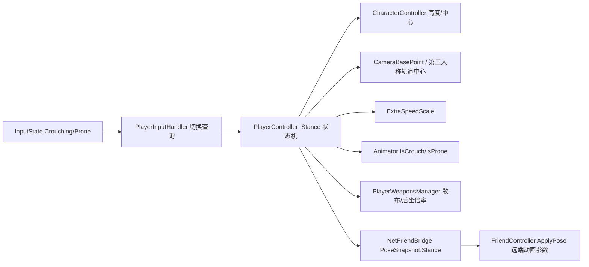

## Product Overview
在现有玩家动作系统上扩展出「下蹲 / 卧倒」两级姿态：按 **C 切换蹲**、按 **Z 切换趴**（键位落在 `InputManager.prefab`，代码只调用 `InputState.Crouching / Prone`），姿态同时驱动角色胶囊体高度、第一/第三人称镜头高度、移动速度与射击稳定性，并把姿态同步给联机盟友。

## Core Features
- **姿态切换（切换式）**：站立 ⇄ 下蹲 ⇄ 卧倒；按 C 在站立/下蹲间切换，按 Z 在站立/卧倒间切换，两个键可互相顶替（趴着按 C 变蹲、蹲着按 Z 变趴）。
- **键位调整**：`Crouching` X(120) → C(99)；`Prone` 保持 Z(122)；原本占 C 的 `Mule`（呼叫 Kei）移到 V(118)；`Equip`（丢弃装备）保持 X(120) 独占。
- **体形与镜头**：切姿态即时收缩/恢复角色胶囊体（脚底不漂移），第一人称镜头高度随身高平滑下降，第三人称轨道中心同步下移。
- **移动手感**：蹲 0.5 倍速、趴 0.2 倍速（Inspector 可调）；仍允许双击冲刺与起跳，但触发时自动先切回立姿再执行。
- **射击更稳**：蹲/趴时子弹散布与后坐力按姿态系数衰减（系数 Inspector 可调，接武器属性口径）。
- **动画占位**：给角色动画控制器补 `IsCrouch` / `IsProne` 两个 bool 参数并实时下发，动画资源待美术后续接线；参数不存在时静默跳过不刷警告。
- **联机同步**：位姿快照带上姿态位，远端盟友的模型同步显示蹲/趴状态；旧版本端缺失该字段按立姿处理。
- **状态收尾**：死亡、复活、进载具（组件被禁用）时强制回到立姿并还原胶囊与镜头。

## 技术栈
Unity 2022.3.62f3 / URP 14.0.12 / C# 9，沿用现有 `CharacterController` 位移体系、`InputManagerBase` 输入表、MessagePack 位姿消息与 FinalIK 管线，不引入新框架。

## 实现思路
0. **键位表（先做）**：改 `Assets/Resources/Prefabs/Manager/InputManager.prefab` 三条 `inputList` 记录的 `positiveMainValue` —— `key:32`(Crouching) 120→99、`key:23`(Mule) 99→118、`key:31`(Prone) 保持 122、`key:22`(Equip) 保持 120。改完用一次 grep 证明 window:1 下再无重复 KeyCode。
   - ⚠ **必须提醒用户**：`InputManager.Init()` 会用磁盘 `inputBindings.json` 整表覆盖 `inputList`（仅按 (key,window) 补缺失项），所以**已有存档的机器上看不到新键位**；需要设置界面点"恢复默认"（`ResetToDefault` 走 `_defaultList` 快照）或删掉该 json。
1. **输入层先解耦命名**：`PlayerInputHandler` 里现有的 `GetCrouchDown/GetCrouch/GetCrouchUp` 实际读的是 `InputState.FlareGun`（左 Ctrl 信号枪），与真正的蹲键撞名 ⇒ 先重命名为 `GetFlareGunDown/GetFlareGunHeld/GetFlareGunUp`（仅 4 处调用，全在 `PlayerWeaponsManager`：`UpdateFlareGun` 两处、`UpdateThrow` 一处、`OnTempWeaponReconcile` 一处），再新增 `GetCrouchToggleDown()` / `GetProneToggleDown()` 读 `InputState.Crouching` / `InputState.Prone`，门控沿用 `CanProcessInput(WindowStateEnum.Game)`。
2. **姿态核心集中在新的 partial 分部**：新增 `PlayerStance` 枚举（Stand/Crouch/Prone）与 `PlayerController_Stance.cs`，用一台最小状态机统一写胶囊、镜头、速度、动画参数，避免逻辑散落在 `Update/LateUpdate/OnDie` 里各自判断。
3. **胶囊改写规则**：`Awake` 记录站立基线（`Controller.height`=2、`Controller.center.y`=1、`CameraBasePoint`），切姿态时写 `height = h` 且 `center.y = h * 0.5f`（脚底不动，`GetCapsuleBottomHemisphere()` 的 `position + up*radius` 口径才不会错位）；`GroundCheck` / `IsPenetrating` / `HaveObstacle` / `IgnoreSelfCollisions` 全部基于 `Controller.height` ⇒ 自动跟随，无需改。
4. **速度不塞 `MoveSpeedScale`**：该 float 已被武器 `MoveSpeedToShoot/MoveSpeedToReload`、`HandEquip.MoveSpeedScaleModifier`、`UpdateSprint` 的 `*= / =` 共同改写，再塞姿态倍率会互相污染 ⇒ 在基类加 `protected virtual float ExtraSpeedScale => 1f;`，只在 `GroundMove()` / `AirMove()` 的目标速度与最大速度上乘一次。
5. **镜头高度**：第一人称直接改 `CameraBasePoint.y`（基类 `LateUpdate` 已有 Lerp 跟随，天然平滑）；第三人称把轨道中心从 `CenterPos` 换成 `CenterPos + Vector3.up * StanceOrbitOffsetY`，只改 `PlayerController_ThirdPerson` 的三处（切视角瞬跳、瞄准/非瞄准两支）与死亡相机一处，不动 `_thirdPersonCameraPoint` 配置值。
6. **射击稳定**：`WeaponBaseController` 增 `StanceSpreadScale`（默认 1，只折进 `CurrentSpreadAngle`，AI/炮塔武器不受影响）；`WeaponPlayerController.RecoilForceFinal` 乘 `StanceRecoilScale`。倍率由 `PlayerWeaponsManager.LateUpdate` 每帧写给当前生效武器（不逐把安装/卸载 `ModifierType`，避免切枪遗漏）。
7. **动画参数**：用脚本给 `Aris/Noa/Nagisa.controller` 的 `m_AnimatorParameters` 追加 `IsCrouch`/`IsProne`（`m_Type: 4`, `m_Controller: {fileID: 9100000}`）；代码侧用 `Animator.parameters` 缓存 `HasParameter`（`SetBody` 后重建），`Kei.controller` 无参数也不会刷 warning。
8. **联机**：`PoseSnapshot` 末尾追加 `[Key(6)] byte Stance`（不改既有 Key 序号；旧端缺键 = 0 = 立姿，天然兼容）；上行在 `NetFriendBridge` 填充，下行 `FriendController.ApplyPose` 加重载直写动画参数。

## 关键取舍
- 不做「起身头顶阻挡检测」（用户明确不选）：站立时若头顶有低矮结构，胶囊会与几何重叠由 CC 自行解算，风险已知并记录在注释里。
- 姿态是离散状态，不走插值（`NetTransformView` 只插值 pos/yaw/pitch），避免 20Hz 包导致姿态抖动。
- 每帧写武器倍率只有两三个浮点赋值，无分配、无 `GetComponent`。

## 架构与数据流


## 目录结构
```
Assets/Resources/Prefabs/Manager/InputManager.prefab # [MODIFY] key32: Crouching 120→99、key23: Mule 99→118
Assets/Scripts/06Gameplay/Player/Controller/
├── PlayerStance.cs                    # [NEW] 姿态枚举 Stand=0/Crouch=1/Prone=2，供玩法层与网络层共用（DTO 只存 byte）
├── PlayerController_Stance.cs         # [NEW] 姿态状态机：切换规则、胶囊高度/中心、CameraBasePoint 与第三人称轨道偏移、ExtraSpeedScale 实现、动画参数下发（HasParameter 缓存）、Inspector 倍率字段
├── PlayerController.cs                # [MODIFY] Awake 记录站立基线；Update 顶部先 HandleStanceInput；TryJump 前自动起身；OnDie/OnRevive/OnDisable 复位；死亡相机轨道中心加姿态偏移
├── PlayerController_ThirdPerson.cs    # [MODIFY] HandleThirdPersonCamera 两支与切视角瞬跳，轨道中心改用含姿态偏移的位置
├── BaseSelfMoveableController.cs      # [MODIFY] 新增 protected virtual float ExtraSpeedScale，GroundMove/AirMove 各乘一次（不动 MoveSpeedScale）
└── FriendController.cs                # [MODIFY] ApplyPose 增加 stance 重载；缓存 _anim 参数存在性并直写 IsCrouch/IsProne
Assets/Scripts/06Gameplay/Player/
├── PlayerInputHandler.cs              # [MODIFY] GetCrouch* → GetFlareGun*；新增 GetCrouchToggleDown/GetProneToggleDown（读 InputState.Crouching/Prone）
└── PlayerWeaponsManager.cs            # [MODIFY] 同步 4 处改名；LateUpdate 把姿态散布/后坐倍率写给当前生效武器
Assets/Scripts/06Gameplay/Weapon/
├── WeaponBaseController.cs            # [MODIFY] 新增 StanceSpreadScale，折进 CurrentSpreadAngle
└── WeaponPlayerController.cs          # [MODIFY] RecoilForceFinal 乘 StanceRecoilScale
Assets/Scripts/07NetGame/Msg/BattleMsg.cs          # [MODIFY] PoseSnapshot 追加 Key(6) byte Stance（注释口径 = PlayerStance）
Assets/Scripts/09Manager/Global/NetFriendBridge.cs # [MODIFY] 缓存本地 PlayerController；上行填 Stance；下行透传给 ApplyPose
Assets/Art/Anim/Student/{Aris,Noa,Nagisa}.controller # [MODIFY] 各追加 IsCrouch/IsProne 两个 bool 参数
.codebuddy/plans/add_stance_anim_params.py         # [NEW] 按 YAML 结构追加动画参数的一次性脚本（跑完核对 git diff，脚本不提交）
```

## 关键结构（口径约定）
```csharp
public enum PlayerStance : byte { Stand = 0, Crouch = 1, Prone = 2 }

// BaseSelfMoveableController：姿态只影响速度上限，不参与 MoveSpeedScale 的累加
protected virtual float ExtraSpeedScale => 1f;

// PlayerController：对外只暴露只读姿态 + 两个倍率（武器层每帧读）
public PlayerStance Stance { get; private set; }
public float StanceSpreadScale { get; }   // 1 / 0.7 / 0.5
public float StanceRecoilScale { get; }   // 1 / 0.75 / 0.55
```

## 执行注意
- 改 CC 高度后**必须**同时写 `Controller.center.y = height * 0.5f`，否则脚底漂移 + 落地判定口径错位。
- 姿态切换只在状态真正变化时写 Animator / 改胶囊，`Update` 内不 `new`、不 `GetComponent`、不拼字符串。
- `MoveSpeedScale` 一律不碰；冲刺仍是 `UpdateSprint` 原有 `*= / =` 逻辑。
- `PoseSnapshot` 只能追加新 Key，禁止重排既有键位序号。
- 键位改完要提醒用户：磁盘 `inputBindings.json` 会覆盖 prefab 键位，需"恢复默认"或删文件才生效。
- 动画控制器是 YAML 资产，脚本改完必须 `git diff` 逐行核对，并确认文件编码/换行未变。
- 编译验证优先 `plans/offline_compile.py`（06/07/09 三个程序集），收尾跑 `check_sources.py`，并对 InputManager.prefab 做一次重复键位自检。

## Agent Extensions
### Skill
- **unity-mcp**：核对 `Player.prefab` 的 `CharacterController`（height/center/radius）、`Main Camera` 局部高度、`InputManager.prefab` 键位真实序列化值，并读取编译结果与 Console 报错。
- **bluedivers-unity**：遵循程序集方向、partial 命名、`[InspectorName]` 用法、`Update` 内零分配等规范落地新脚本。
- **kcpnet-online**：按既有 DTO 约定给 `PoseSnapshot` 追加 Key(6) 并确认 MessagePack 旧端缺键为 0 的兼容路径。
