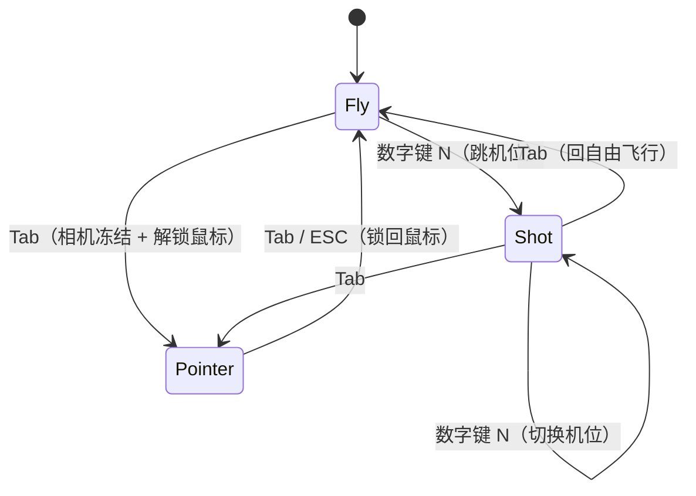
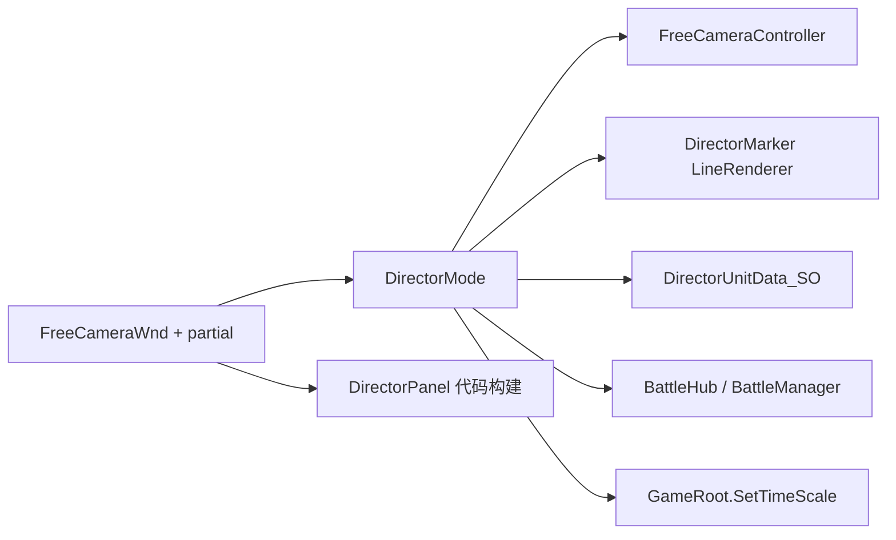

## 用户需求
把现有的自由相机（`FreeCameraController` + `FreeCameraWnd`）升级成一套可用的 **PV 导演/拍摄工具**，让它在实机运行中完成取景、控时、布置演员与战备。

## 产品概述
进入"自由视角"后不再只是一个飞行的相机，而是一个带侧边导演面板的拍摄台：可以在飞行取景、固定机位、选点布置三种状态间切换；可以精确控制时间（暂停 / 慢放 / 逐帧）；用鼠标点击地面就能得到一个落点标记，然后在这个落点上生成单位或释放战备。面板同时显示当前模式、倍率、机位序号与落点坐标，并给出键位图例。

## 核心功能
- **三态切换**：飞行（鼠标锁定、WASD 取景）/ 固定机位（相机锁死、世界继续运行）/ 选点（相机锁死、解锁鼠标、左键点地面）。
- **机位系统**：9 个机位槽，一键保存当前位姿（位置 / 朝向 / FOV），一键跳转，跳转带短促平滑过渡。
- **时间控制**：倍率档位（1 / 0.5 / 0.2 / 0.05 / 0.005）＋ 暂停/继续 ＋ 单逻辑帧步进（暂停时有效）。
- **地面选点**：左键在面板外的画面点击地面 → 落点显示环形标记 + 竖直光柱，状态栏显示坐标；可清除。
- **定点生成单位**：面板列出 PV 专用单位白名单（敌 / 友 / 载具 / 道具，按分类前缀标识），点选后按生成键在标记点创建；生成物挂到 ActorsManager 下并跳过出生延迟。
- **定点释放战备**：面板列出可用战备（图标 + 名称），点选后按释放键在标记点呼叫该战备。
- **面板与图例**：导演面板可整体显隐（沿用现有 H 键），底部常驻键位说明；无白名单资产或未设落点时给出明确提示而不是静默失败。
- **退出还原**：离开自由视角时恢复 1 倍速、锁回鼠标、清除标记、关闭面板。

## 边界（本期明确不做）
- 不做相机关键帧运镜曲线、不做轨迹录制、不做截图/序列帧、不做机位持久化（关掉游戏即失）。
- 不做"导演模式下操控玩家角色"：`FreeCamera` 状态下玩家输入本来就被屏蔽，放开需要另行处理主相机接管与 WASD 争抢，留待下期。
- 生成与战备仅面向单机 / 房主场景，联机成员端不参与生成。


## 技术栈
- Unity 2022.3.62f3 / URP 14.0.12 / C# 9，沿用项目既有 uGUI + TextMeshPro + 裸 `KeyCode` 热键风格。
- 不改 `WndType` / `WndHub`：导演模式继续由 `WindowStateEnum.FreeCamera`（`WindowStateController` 硬连线，`GameRoot.prefab:15609`）进入。

## 实现方案

### 1. 分层与关键决策
| 决策 | 选择 | 理由 |
|---|---|---|
| 导演逻辑落点 | `10_Effect/Director/DirectorMode.cs` | 它要调用 `09_Managers`（BattleManager/ResSvc/ActorsManager）与 `04_Data`，`10_Effect.asmdef` 已引用这两层；`10_UI` 增量加一条 `"10_Effect"` 引用即可（10_Effect 不引用 10_UI，无环） |
| 面板构建 | **运行时用代码构建 uGUI**（`DirectorPanel.cs`） | 该 prefab 现由 MCP 反复存取风险高（已知 `SaveAsPrefabAsset` 会回写内存旧值清掉未触碰字段）。纯代码构建把 prefab 改动降到 0，结构演进只改代码 |
| 中文字体 | 复用现成 TMP | 面板字体直接取 `showTime` 上 `TMP_Text.font`（`MSYH SDF`，`FreeCameraWnd.prefab:200`），不写 `Resources.Load` 取字体 |
| 单位来源 | 新增 `DirectorUnitData_SO` 白名单 | 用户已拍板；避免 `WaveManager` 依赖 `nowTask.campData` 的空引用，也避免污染 `SpawnableTable` |
| 生成方式 | `Object.Instantiate(prefab, pos, rot, ActorsManager.Instance.transform)` | 单机/房主可用；镜像 `WaveManager.cs:620-625` 的 `BirthDuration=0` / `IsFixed=true` |
| 战备释放 | `BattleHub.Current.ReleaseAirdrop(point, id)` | 契约入口（`IBattleService.cs:59`），跨层合规，不用碰 `AirdropController` 的私有交互链 |
| 时间写入 | `GameRoot` 增 `SetTimeScale(float, bool log)` 静默重载 | 现有 setter 每次都 `Debug.LogWarning`（`GameRoot.cs:27`），逐帧步进会刷屏 |

### 2. 状态机

- `Fly`：`FreeCameraController.InputEnabled = true`，鼠标锁定；沿用现有 WASD / C 环绕 / Aim 变焦 / 滚轮。
- `Shot`：相机 `SnapTo(shot)` 后 `InputEnabled = false`，鼠标仍锁定，世界按当前倍率运行。
- `Pointer`：相机冻结，`Cursor.lockState = None` + `visible = true`，左键拾取。

### 3. 时间控制
- 档位 `1 / 0.5 / 0.2 / 0.05 / 0.005`，`[` `]` 循环；`J` 在 0 与上次非零档之间切换（保留现有 J 语义）。
- 单帧步进（`,`）：协程把 `Time.timeScale` 临时设为 `Constants.LoginFrame.RawFloat / max(unscaledDeltaTime, 1e-4)`，让**一个渲染帧恰好推进一个 50Hz 逻辑帧**，`yield return null` 后还原。这样 `LogicFrameHost`（`Time.deltaTime` 累加）与 Update 驱动的 AI 位移同步前进一帧；面板文案写"逻辑帧"，不写"渲染帧"。
- 进入导演模式默认倍率由 `0.005` 改为 `0.2`（0.005 取景与布置几乎看不到变化），退出恢复 `1`。

### 4. 拾取与生成流程
1. `InputManager.GetDown(InputState.Fire)`（window:4 已绑 Mouse0）且 `!EventSystem.current.IsPointerOverGameObject()`；
2. `Camera.ScreenPointToRay(Input.mousePosition)` + `Physics.Raycast(..., 2000f, _groundLayer)`（纯 Ground 层 `m_Bits:8`，与 `FreeCameraController` 一致）；
3. 命中失败只打一条日志、保留旧标记（不写降级链）；命中成功吸到 `NavMesh.SamplePosition` 后再刷新标记；
4. 生成时 `pos + Random.insideUnitCircle * entry.scatterRange` 再 `NavMesh.SamplePosition` 吸附（仅当命中）。

### 5. 架构与数据流

`FreeCameraWnd` 只做"键位转发 + 面板刷新"，所有世界操作收敛在 `DirectorMode`，便于下期加"选中并指挥单位"而不动 UI 层。

### 6. 性能要点
- 面板、列表行、标记 LineRenderer **只构建一次**；列表仅在切分类/白名单变化时重建，避免每帧 `Instantiate`。
- 状态文本与 `showTime` 文本按 **5Hz 节流**刷新（现有 `FreeCameraWnd.cs:42` 每帧 `string.Format` 有 GC 压力）。
- `Update` 内不 `GetComponent`/`Find`/字符串拼接；拾取只在按下帧执行。
- `Physics.Raycast` 单次、带 LayerMask，不做 `RaycastAll`。

## 关键代码结构

```csharp
public enum DirectorUnitCategory { Enemy, Friend, Vehicle, Prop }

[Serializable]
public class DirectorUnitEntry
{
    [InspectorName("显示名")] public string showName;
    [InspectorName("预制体")] public GameObject prefab;
    [InspectorName("分类")] public DirectorUnitCategory category;
    [InspectorName("落点抖动半径")] public float scatterRange;
}
```

```csharp
public enum DirectorState { Fly, Shot, Pointer }

public class DirectorMode : MonoBehaviour
{
    public DirectorState State { get; }
    public float Rate { get; }
    public bool HasMarker { get; }
    public Vector3 MarkerPoint { get; }

    public void Enter();
    public void Exit();
    public void SetRate(float rate);          // 静默写 GameRoot.SetTimeScale
    public void TogglePause();
    public void StepOneTick();                // 协程：推进一个逻辑帧
    public void TogglePointer();
    public void SaveShot(int index);          // 1..9，存位姿 + FOV
    public void GotoShot(int index);          // 无该机位则一条日志 return
    public bool TryPickGround(out Vector3 point);
    public GameObject SpawnUnit(DirectorUnitEntry entry);   // 内部判标记点/白名单
    public void ReleaseAirdrop(AirdropData_SO data);
}
```

## 目录结构
```
Assets/
├── Scripts/
│   ├── 04Data/
│   │   └── DirectorUnitData_SO.cs            # [NEW] PV 单位白名单 SO。定义 DirectorUnitEntry / DirectorUnitCategory 与 List<DirectorUnitEntry>；CreateAssetMenu = "Data/PV导演单位表"；仅依赖 GameObject 与基础类型，符合 04_Data 依赖约束。
│   ├── 09Manager/Global/
│   │   └── GameRoot.cs                       # [MODIFY] 新增 public static void SetTimeScale(float value, bool log = true)，原 TimeScale setter 转发到该方法；供逐帧/频繁改倍率时静默写入，避免每帧 LogWarning。
│   ├── 10_Effect/
│   │   ├── FreeCameraController.cs           # [MODIFY] 新增 InputEnabled（false 时 Update 直接 return，但保留 LateUpdate 到位插值）、SnapTo(pos, rot, fov)（同时重置 targetPoint/_scrollMomentum，避免被残留目标拉走）、SetFov(float)、GroundMask 只读属性；保持 C 环绕与 Aim 变焦原逻辑。
│   │   └── Director/
│   │       ├── DirectorMode.cs               # [NEW] 导演核心控制器：三态状态机、9 机位（存/跳 + unscaled 0.35s 插值过渡）、倍率与暂停与单帧步进、地面拾取、标记点维护、按白名单生成单位、释放战备、光标与 FreeCameraController.InputEnabled 联动；联机成员端生成前一条日志并 return。
│   │       └── DirectorMarker.cs             # [NEW] 落点可视化：单个 LineRenderer 画 48 段地面圆环 + 4 段指向刻度 + 2 点竖直光柱，材质 Shader.Find("Sprites/Default") 取不到时 LogError 后不自建；Show(pos)/Hide() 复用同一实例，不改层级。
│   ├── 10UI/
│   │   ├── 10_UI.asmdef                      # [MODIFY] references 增加 "10_Effect"（10_Effect 不引用 10_UI，不构成环）。
│   │   ├── Director/
│   │   │   └── DirectorPanel.cs              # [NEW] 纯代码构建的导演面板（非 Window 子类）：标题/状态文本、9 个机位按钮 + 存机位开关、单位滚动列表、战备滚动列表、生成/释放按钮、底部键位图例；Build(parent, font) 只执行一次，暴露回调与 Refresh 接口，行节点池化复用。
│   │   └── Wnd/
│   │       ├── FreeCameraWnd.cs              # [MODIFY] 改为 partial class；ShowWnd 改为调用 DirectorMode.Enter()（默认倍率 0.2、锁鼠标、隐藏标记），HideWnd 调用 Exit() 并恢复 1 倍速与光标；Update 保留 H/U/调速/showTime 并加 5Hz 节流，其余热键转发到 partial。
│   │       └── FreeCameraWnd_Director.cs     # [NEW] 分部文件：FirstShowWnd 里缓存 DirectorMode 与 showTime 字体、构建 DirectorPanel；实现 Tab / 1-9 / Ctrl+1-9 / [ ] / J / , / Enter / T / Backspace 键位处理与列表选中、面板刷新；子类仍不定义 Awake/OnEnable。
└── Resources/GameData/Director/
    └── DirectorUnitData.asset                # [NEW] 空白名单资产，由用户在 Inspector 拖入常用敌/友/载具预制体；加载路径固定为 "GameData/Director/DirectorUnitData"。
```

## 实施注意
- `FreeCameraWnd` 及其分部**不得**出现 `Awake`/`OnEnable`（会静默顶掉 `Window.Awake` 的自注册，`Window.cs:76-92`）。
- 所有 prefab 资产本次**零改动**，若后续要加 Inspector 可调项，优先序列化字段而非改 prefab 层级。
- `GameRoot.TimeScale` 已有订阅者（`MouseMoveEffect` 拖尾按比例缩放），直接写 `Time.timeScale` 会漏事件，必须走 `SetTimeScale`。
- 右键与 ESC 会被 `InputManager` 的 cancel 栈优先消费（`InputManagerBase.cs:195`），因此选点用左键。
- `LayerDefinition.GroundLayers` 含 Default(0)，不能当"地面层"用；拾取沿用 `FreeCameraController._groundLayer`（纯 Ground）。
- 白名单为空、缺资产、未设标记点三类情况：各打一条日志 + 面板显示占位文案，不写降级链、不 `?? new`。
- 编码 UTF-8 with BOM；注释 1~3 行讲为什么与陷阱；大括号另起新行；私有字段 `_camelCase`；`const` 置类顶部。
- 验证顺序：`plans/offline_compile.py 04_Data 09_Managers 10_Effect 10_UI` → Unity `refresh_unity` + `read_console` 0 error + `is_compiling:false` → 用户进 Play 按验收清单逐条走。


### Skill
- **bluedivers-unity**
  - Purpose: 在写 04_Data / 10_Effect / 10_UI 三个程序集的代码、改 asmdef 引用、新增窗口分部文件时，按项目既定的命名、目录、程序集依赖与 UI 窗口约定落地，避免跨层引用错误与 `Awake` 覆写这类静默缺陷。
  - Expected outcome: 新增文件落在正确目录、asmdef 引用合法无环、窗口类保持 `FirstShowWnd` 初始化范式，离线编译 0 error。

### Skill
- **unity-mcp**
  - Purpose: 通过 MCP 创建 `DirectorUnitData.asset`、刷新并编译脚本、读 Console 确认 0 error、进 Play 后截图核对导演面板实际渲染效果。
  - Expected outcome: 资产创建成功且路径为 `Assets/Resources/GameData/Director/DirectorUnitData.asset`；编译与 Console 双证通过；截图显示面板、状态栏与标记环正常。

### MCP
- **unityMCP**
  - Purpose: 执行 `create_script`/`apply_text_edits` 落代码、`manage_scriptable_object` 建白名单资产、`refresh_unity` + `read_console` 做编译三证、`manage_camera` 或 `execute_code` 抓运行截图验收。
  - Expected outcome: 脚本落盘且通过编译，资产可被 `ResSvc` 加载，Play 实测截图可作为交付证据。
